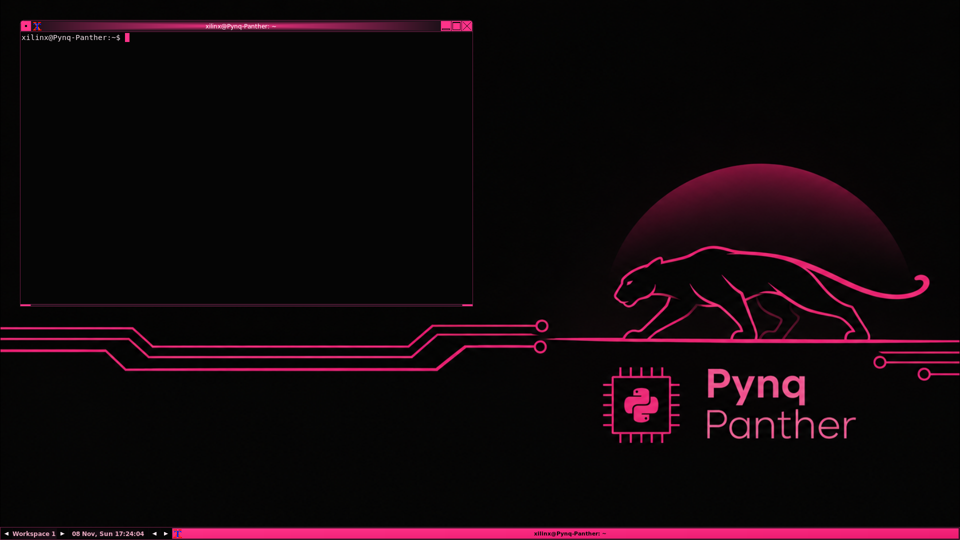

<p align="center"></p>

# pynq-panther

A graphical desktop on the HDMI output of a stock **PYNQ-Z2** (PYNQ v3.1), in a pink-and-black theme with the *Pynq Panther* wallpaper, with working USB mouse and keyboard, a web browser, a file manager and a
code editor for developing on the board itself, the board's buttons, switches and LEDs as normal Linux devices, and an experimental sound card. **No custom FPGA design**: everything runs on
PYNQ's standard *base overlay*.

> **New to the PYNQ-Z2?** This project builds on the stock PYNQ image, and PYNQ's own documentation is the place to learn the board:
> [PYNQ-Z2 setup](https://pynq.readthedocs.io/en/v3.1/getting_started/pynq_z2_setup.html), [Getting started](https://pynq.readthedocs.io/en/v3.1/getting_started.html),
> [the PYNQ-Z2 base overlay](https://pynq.readthedocs.io/en/v3.1/pynq_overlays/pynqz2.html) and [the PYNQ libraries](https://pynq.readthedocs.io/en/v3.1/pynq_libraries.html).
> [`docs/PYNQ-RESOURCES.md`](docs/PYNQ-RESOURCES.md) is a guide to all of it, including how PYNQ's notebooks run next to this desktop (the installer makes them safe).

<p align="center"></p>

```sh
git clone https://github.com/jwkunz/pynq-panther.git
cd pynq-panther
./install.sh          # a few minutes the first time (it builds against your running kernel); then reboot-proof
```

The desktop starts at every boot, after PYNQ has loaded the base overlay. **If anything fails, the board stays headless exactly as it was.**
**Step-by-step guide for every network situation** (router, sharing a PC's Wi-Fi through the Ethernet cable, or no network at all): [`docs/INSTALL.md`](docs/INSTALL.md).

**No internet on the board?** Download `panther-offline-bundle-*.tar.gz` from the [latest release](https://github.com/jwkunz/pynq-panther/releases/latest) on another computer, unpack it next to `install.sh`, and run `./install.sh` (book chapter 9, section 9.10).
Turn it off with `enabled = false` in `/etc/panther/panther.conf`; remove everything with `./install.sh --uninstall`.

## What is in the box

| Part | Language | What it does |
|---|---|---|
| `kmod/panther_drm` | C (kernel module) | DRM/KMS driver for the base overlay's HDMI output: `/dev/dri/cardN`, dumb buffers, page flips, 1080p30 and smaller modes |
| `kmod/panther_audio` | C (kernel module) | **Experimental** ALSA sound card for the headphone/line-in/microphone codec (a polling thread: costs one CPU core while sound plays) |
| `session` (`panther-session`) | Rust | At boot: wait for the PL, load the driver, start Xorg (modesetting) and fluxbox. Any failure leaves the board headless |
| `config/` | | settings, session script, systemd units, GPIO devicetree overlay, udev rule |
| `install.sh` | bash | checks, installs packages, prepares the kernel headers, builds, installs, enables; `--offline DIR` installs with no internet |
| `scripts/panther-mode` + `config/pynq-guard/` | bash, Python | the PYNQ guard (stock notebooks can load `base.bit` next to the desktop) and `panther-mode` (a clean switch for everything else) |
| `scripts/make-offline-bundle.sh` | bash | builds the offline package bundle (71 packages, 160 MB) on a connected board |
| `tests/` | C | `kms_probe` (modes + page flips without X), `fb_bench` (framebuffer speeds) |
| `docs/` | | [INSTALL.md](docs/INSTALL.md), [PYNQ-RESOURCES.md](docs/PYNQ-RESOURCES.md) (the official PYNQ documentation, mapped), and the textbook `docs/book/` |

The kernel modules are C because the board's kernel has no `CONFIG_RUST`; the user-space supervisor is Rust.

**Learning the board itself?** Start with the official PYNQ documentation: [`docs/PYNQ-RESOURCES.md`](docs/PYNQ-RESOURCES.md).

**Learning from this repository?** Start at [`docs/book/README.md`](docs/book/README.md): an eleven-chapter text on the Zynq hardware,
video timing, the Linux graphics stack, kernel modules, a line-by-line driver walkthrough, booting, input, audio, installation and real debugging stories.

## What works (tested on a PYNQ-Z2, PYNQ v3.1, kernel 6.6.10-xilinx-v2024.1)

| | State |
|---|---|
| HDMI desktop at boot: Xorg + fluxbox + xterm at 1920x1080 | works (user-confirmed on a monitor) |
| USB keyboard and mouse | works (user-confirmed) |
| Modes: 1920x1080@30, 1366x768, 1280x800, 1280x720, 1024x768, 800x600, 640x480; switching with `xrandr` | the first five original modes switch cleanly (register read-back); 1366x768 and 1280x800 are listed by X but were not looked at on a monitor |
| Desktop menu (right-click): Terminal, File manager (PCManFM), Web browser (Epiphany), Jupyter, Geany editor, micro, display resolution | works (browser and Geany launched from the menu; user-confirmed) |
| Host name `Pynq-Panther` announced as `pynq-panther.local` (mDNS) with SSH and Jupyter services; resolves from this PC | works (checked from the board and from the PC) |
| Pink-and-dark theme with the **Pynq Panther wallpaper**: colours sampled from the picture; window manager, menus, terminal, GTK3 and GTK2 programs, Geany editor; right-click *Colour theme* menu; `--wallpaper FILE` / `--no-wallpaper` | works (screenshots from a cold boot, GTK2 and GTK3 programs, the menu switches styles) |
| Offline install: bundle built, packages removed, internet route deleted, `./install.sh --offline` ran to the end | works (every package from `file:`, no network references; an older bundle without the optional apps only warns) |
| Buttons (key events), switches (switch events), 10 LEDs (`/sys/class/leds`) via a devicetree overlay | works (LED writes and switch reads checked in hardware registers; button presses not pressed by hand) |
| Stock PYNQ notebook `BaseOverlay("base.bit")` with the desktop running (plain Python and a Jupyter notebook): LEDs and buttons work, 0 clock/firmware writes, desktop and wallpaper intact; a different design is refused with an explanation | works (measured; the HDMI/audio notebooks still need `panther-mode pynq`) |
| Page flips with completion events | works (`tests/kms_probe`) |
| Jupyter keeps working alongside | works |
| Sound card `panther_audio` - **playback** | works: a 5 s test tone played in 4,981 ms and was heard on the headphone jack (user-confirmed) |
| Sound card - **capture** | delivers samples at the exact rate (96,000 frames in 2 s) from line-in and mic; recording quality not judged (no source connected) |
| Boot with `install.sh` from a copy of the repo: build, install, reboot, desktop + GPIO + audio come up by themselves, FPGA loaded once | works |
| Install straight from `git clone` (`./install.sh` on a clean checkout, kernel tree already prepared) | works |
| Reboot loop / freeze when the services start | **fixed**: the units used `Wants=bootpy.service`, which re-ran PYNQ's `boot.py` and reloaded the FPGA under the running display (book chapter 10, Tale 9) |

Measured: copying into the scan-out buffer runs at 491 MB/s (a 1080p frame in 17 ms); reading it, 82 MB/s, which is why X uses a shadow copy.

## Limits

* **VS Code was tested and dropped**: on this board it used about 450 of 491 MB of RAM and was laggy. Geany and micro are the editors; a laptop's VS Code can edit the board over SSH (book chapter 12).
* **No HDMI audio.** The base overlay's HDMI encoder is DVI-only; sound uses the analog codec jacks.
* **No GPU, no hardware cursor.** The base overlay has none; X draws in software (NEON-optimised pixman) and draws the pointer itself.
* **1080p30 is the largest mode** because the base overlay's video DMA has a 32-bit memory port (1080p60 needs about 500 MB/s).
* **No EDID**: the output has no DDC wiring, so the mode list is fixed (plus anything you add with `xrandr --newmode`).
* **Audio costs a CPU core while a stream is open** (polling thread, no FIFO/DMA/interrupt in the base overlay) and has no mixing; 48 kHz stereo 24-bit only.
* **Reprogramming the FPGA under a running desktop freezes the board.** Stock PYNQ notebooks do that on their first line, so the installer adds a guard: `BaseOverlay("base.bit")` (68 of the 77 tutorial notebooks) now skips the reprogramming and runs unchanged next to the desktop; a *different* overlay is refused with an explanation. Notebooks that drive HDMI or audio, or load other overlays, need `sudo panther-mode pynq` first (and `sudo panther-mode desktop` afterwards). See [`docs/PYNQ-RESOURCES.md`](docs/PYNQ-RESOURCES.md), section 6.
* **Double-buffered shadow updates** (tear-free X) were tried and reverted until they can be judged on a monitor; the supervisor's default is single shadow.
* A notebook that loads another overlay, or uses PYNQ's `HDMIOut`, will fight the kernel driver for the same hardware.

## Layout

```
install.sh            one-command installer (and --uninstall)
kmod/panther_drm/     display driver            kmod/panther_audio/  experimental audio driver
session/              Rust supervisor           config/              units, settings, GPIO overlay, udev rule
scripts/              helpers (deploy from a PC, GPIO overlay loader)
tests/                kms_probe.c, fb_bench.c   docs/                hardware.md and the book (docs/book/)
```

## Tested on, and security notes

* **Tested on:** PYNQ-Z2, PYNQ v3.1 image (Ubuntu 22.04, armv7, kernel 6.6.10-xilinx-v2024.1), HDMI monitor at 1920x1080. **Not yet tested:** the Windows and
  macOS Internet-sharing steps in `docs/INSTALL.md`, and the 1366x768 / 1280x800 modes on a real monitor.
* **Default credentials.** The stock PYNQ image uses the user `xilinx` with the password `xilinx`, and this project announces the board as `pynq-panther.local`
  (SSH and Jupyter). Change the password (`passwd`) before putting the board on a network you do not control. See [`SECURITY.md`](SECURITY.md).
* **Licence:** GPL-2.0 ([`LICENSE`](LICENSE)). **Contributing and bug reports:** [`CONTRIBUTING.md`](CONTRIBUTING.md).
